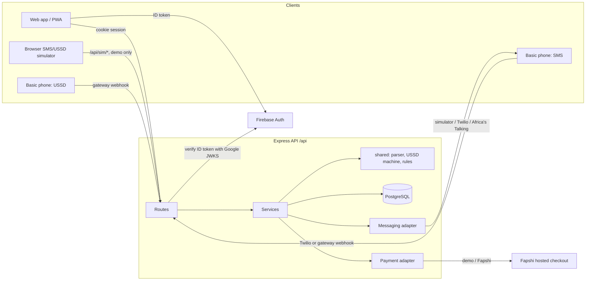

# Architecture

MEDIMATE is one TypeScript monorepo (npm workspaces) with three packages. The same accounts and data are reached from the web app, SMS and USSD.

```
shared/   framework-free logic: Zod schemas, SMS parser, USSD state machine, stock freshness,
          entitlements, units, time zones, CSV import, phone numbers, adherence maths
server/   Express 5 API, Drizzle ORM on PostgreSQL, provider adapters, reminder engine
web/      React 19 + Vite + Tailwind v4 + TanStack Query + React Router (mobile first, PWA shell)
```

## Request flow



## Boundaries

| Concern | Where | Notes |
|---|---|---|
| Validation contracts | `shared/src/schemas.ts` | The same Zod schemas validate forms in the web app and requests on the server. |
| SMS commands | `shared/src/sms/parser.ts` (pure) and `server/src/services/sms.ts` (I/O) | The parser has no clock or database, so it is unit-tested in isolation. |
| USSD menus | `shared/src/ussd/machine.ts` (pure) and `server/src/services/ussd.ts` | The machine talks to data through an injected port. |
| Stock freshness and price comparison | `shared/src/stock.ts` | Reports older than 48 hours are stale and never count as the lowest price. |
| Trial and premium features | `shared/src/entitlements.ts`, `server/src/services/users.ts` | Enforced on the server for every premium route; the UI only reflects it. |
| Reminders | `server/src/services/reminders.ts`, `server/src/scheduler.ts` | Database-backed, idempotent; see [REMINDERS.md](REMINDERS.md). |
| Messaging | `server/src/providers/messaging.ts` | One interface; simulator, Twilio, Africa's Talking. |
| Payments | `server/src/providers/payments.ts`, `server/src/services/billing.ts` | Demo checkout or Fapshi; see [PAYMENTS_FAPSHI.md](PAYMENTS_FAPSHI.md). |
| Authentication | `server/src/services/auth.ts`, `server/src/services/firebase.ts` | Phone OTP and Firebase ID tokens; see [AUTH.md](AUTH.md). |
| Authorization | `server/src/middleware.ts` plus every service | Role check at the route, ownership and consent checks in the service. |
| Audit | `server/src/lib/audit.ts` | Append-only table; the database rejects UPDATE and DELETE on it. |

Route handlers stay thin: they parse input with a shared schema, call one service function, and return its result. Business rules live in services and in `shared/`.

## Runtime shapes

**Local development.** `npm run dev` starts the API on port 3001 (in-process scheduler every 30 s) and Vite on 5173 with `/api` proxied. Without `DATABASE_URL` the API uses PGlite, real PostgreSQL compiled to WebAssembly, stored in `server/.data/pglite`. Migrations run and fictional demo data is seeded on first start.

**Container or VM.** `npm run build` then `npm start` runs the same API as a long-running process against `DATABASE_URL`, with the in-process scheduler. Serve `web/dist` from any static host or a reverse proxy.

**Vercel.** `scripts/vercel-build.mjs` writes Build Output API v3: the web app as static files and the API as one Node.js function. There is no long-running process, so the reminder engine runs on API requests (throttled to once per 30 s), from the simulator, and from a daily cron. See [DEPLOYMENT.md](DEPLOYMENT.md).

## Sessions and CSRF

Sign-in creates a random session token. The browser holds it in an `httpOnly`, `SameSite=Lax` cookie (`Secure` in production); the database stores only its SHA-256 hash. State-changing requests must come from the app's own origin (Origin header check), except provider webhooks, which authenticate with shared secrets or signatures instead.

## Time

All timestamps are stored in UTC. Each person and each medicine plan carries an IANA time zone (default `Africa/Douala`, UTC+1, no daylight saving). Reminder times are local wall-clock times converted to UTC per day, so a plan stays correct even for zones with daylight saving (tested in `shared/test`).

## Internationalisation

English is authored. French SMS/USSD strings are drafts marked unreviewed; the French and Cameroonian Pidgin web locale files are placeholders that fall back to English. Nothing is machine translated.
