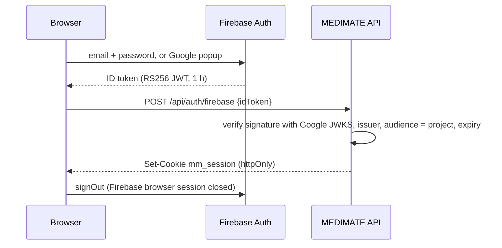

# Sign-in and accounts

Code: [`server/src/services/auth.ts`](../server/src/services/auth.ts), [`server/src/services/firebase.ts`](../server/src/services/firebase.ts), [`web/src/lib/firebase.ts`](../web/src/lib/firebase.ts), [`web/src/pages/public/Login.tsx`](../web/src/pages/public/Login.tsx).

One MEDIMATE account can have any of three sign-in methods: a phone number (code by SMS), an email and password, or Google. The phone number is what SMS and USSD use, so the same person can switch between web and basic phone.

## Phone code (OTP)

1. `POST /api/auth/otp/request {phone}`. The number is normalised to E.164 (`6XX XX XX XX` becomes `+2376XXXXXXXX`). The response text is identical whether or not the number has an account.
2. A 6-digit code is stored only as an HMAC (keyed with `APP_SECRET`), valid **5 minutes**, at most **5 attempts**, at most **3 codes per number per 15 minutes**, and the endpoint is rate-limited per IP.
3. `POST /api/auth/otp/verify {phone, code}` consumes the code once, creates the account on first sign-in (trial starts now, server time), and sets the session cookie.

### When is the code shown on screen?

Only when `OTP_PROVIDER=dev` **and** one of these is true:

- the number is fictional, `+237 600 xxx xxx` (the demo accounts), or
- `MESSAGING_PROVIDER=simulator` (local development: nothing can be delivered anyway).

On a production build (`NODE_ENV=production`) this is allowed only with `PUBLIC_DEMO=true`, and the public demo refuses real numbers unless a real SMS provider is configured. In every other case the code goes out **by SMS** through the configured provider, and the code is never written to the SMS log. The UI labels an on-screen code as a demo code for a fictional number.

## Email and Google (Firebase Authentication)

Firebase proves who the person is; MEDIMATE keeps its own session.

- No service-account key is needed: the server verifies ID tokens with `jose` against Google's public keys, as documented by Firebase for third-party JWT libraries.
- Matching: first by Firebase uid; otherwise by email **only if Firebase says the email is verified**. An unverified email that matches an existing account is refused, which prevents account takeover by registering someone else's address.
- Configuration (public by design, not secrets): `FIREBASE_PROJECT_ID`, `FIREBASE_API_KEY`, `FIREBASE_AUTH_DOMAIN`, `FIREBASE_APP_ID`. Without them the email and Google options are hidden and `POST /api/auth/firebase` returns `NOT_CONFIGURED`.
- The Firebase SDK is loaded only on the sign-in page, so the rest of the app stays light.

### Firebase console checklist

1. Create a project (Analytics not needed).
2. Authentication, Sign-in method: enable **Email/Password** and **Google** (set a support email).
3. Project settings, Your apps: add a **Web app**; copy `apiKey`, `authDomain`, `projectId`, `appId` into the env vars above.
4. Authentication, Settings, **Authorized domains**: `localhost` is there by default; add your deployed domain (for example `your-project.vercel.app`). Google sign-in fails with `auth/unauthorized-domain` until you do.

## Linking methods to one account

From **Me, Sign-in methods** (Settings):

- **Add phone**: `POST /api/me/link/phone/request` then `/verify`. If that number already has its own account (for example it registered by SMS), linking is refused with a message telling the person to sign in with the phone code and add the email from there, so two accounts are never merged silently.
- **Add email or Google**: `POST /api/me/link/email {idToken}`. Refused if that Firebase identity or email belongs to another account.

Linking a phone also claims any caretaker invitations sent to that number. Every link is written to the audit log.

## Sessions

- Random 32-byte token in the `mm_session` cookie: `httpOnly`, `SameSite=Lax`, `Secure` when `NODE_ENV=production`, 7 days.
- The database stores only the SHA-256 of the token, so a database leak does not reveal live sessions.
- Sign out deletes the session row. Account deletion deletes all sessions.

## Roles

`patient`, `caretaker`, `pharmacy`, `admin`, `reviewer`. Roles are granted by admins (audited) or by actions (accepting a caretaker invite, registering a pharmacy). The server checks the role at the route and ownership or link status in the service, on every request.

## Demo accounts

Fictional, local and public demo only. Sign in with the phone number; the code appears on screen.

| Number | Person | Roles |
|---|---|---|
| 600 000 001 | Ama | patient, active trial, reminders, readings, caretaker link |
| 600 000 002 | Ben | patient, trial ended (premium locked) |
| 600 000 003 | Clara | patient + caretaker for Ama |
| 600 000 004 | Dan | patient + pharmacy staff (Demo Pharmacy Molyko) |
| 600 000 005 | Eve | patient + admin |
| 600 000 006 | Femi | patient + clinical reviewer |
| 600 000 007 | Gina | patient + pharmacy staff (Demo Pharmacy Great Soppo) |
