# Data model

Source of truth: [`server/src/db/schema.ts`](../server/src/db/schema.ts) (Drizzle ORM, PostgreSQL). Migrations live in [`server/drizzle/`](../server/drizzle) and are committed; `npm run db:generate` creates a new one after a schema change.

Conventions:

- Primary keys are UUIDs. Timestamps are `timestamptz` in UTC; calendar dates that belong to a person's day (`local_date`, `start_date`) are `date` columns read with the person's IANA time zone.
- Money is `numeric(12,2)` with an explicit currency (XAF by default). Readings are `numeric` with an explicit canonical unit, and the value and unit the person typed are kept next to it.
- Status columns are text values validated in code (`shared/src/constants.ts`), never a single boolean, so pending, rejected, expired and suspended stay distinct.
- Stock "unknown" is different from "out". Freshness is derived from `pharmacy_stock.updated_at` at read time (48 hours).
- `audit_logs` is append-only: migration `0001_audit_append_only.sql` adds a trigger that rejects UPDATE and DELETE.

## Entity relationship diagram

```mermaid
erDiagram
  users ||--o{ user_roles : has
  users ||--o{ sessions : "signs in with"
  users ||--o{ consents : "grants or withdraws"
  users ||--o{ care_links : "patient of"
  users |o--o{ care_links : "caretaker in"
  users ||--o{ pharmacy_staff : "works at"
  pharmacies ||--o{ pharmacy_staff : employs
  pharmacies ||--o{ pharmacy_hours : opens
  pharmacies ||--o{ pharmacy_verifications : "verification history"
  pharmacies ||--o{ pharmacy_stock : reports
  medicines ||--o{ pharmacy_stock : "stocked as"
  medicines ||--o{ medicine_reviews : "review history"
  pharmacy_stock ||--o{ stock_events : "change history"
  pharmacies ||--o{ reports : "reported in"
  pharmacy_stock |o--o{ reports : about
  users |o--o{ reports : files
  users ||--o{ inquiries : asks
  pharmacies ||--o{ inquiries : receives
  inquiries ||--o{ messages : contains
  users ||--o{ medication_plans : records
  medicines |o--o{ medication_plans : "matched to"
  users ||--o{ checkups : plans
  medication_plans |o--o{ reminder_occurrences : schedules
  checkups |o--o{ reminder_occurrences : schedules
  users ||--o{ reminder_occurrences : receives
  reminder_occurrences ||--o{ reminder_events : "taken, skipped, follow-up, escalated"
  users ||--o{ vital_readings : logs
  users ||--o{ step_logs : logs
  users ||--o{ water_logs : logs
  users ||--o{ reaction_logs : logs
  users ||--|| subscriptions : "trial and premium"
  users ||--o{ payments : pays
  users |o--o{ sms_logs : "sent or received"

  users {
    uuid id PK
    text phone UK "E.164, optional"
    text email UK "from Firebase, optional"
    text firebase_uid UK
    bool email_verified
    text display_name
    date date_of_birth
    text language
    text area
    text timezone
    int step_goal
    int water_target_ml
    text created_via "web, sms, ussd"
    timestamptz onboarded_at
    bool is_demo
  }
  user_roles {
    uuid user_id PK
    text role PK "patient, caretaker, pharmacy, admin, reviewer"
  }
  sessions {
    uuid id PK
    uuid user_id FK
    text token_hash UK "SHA-256 of the cookie token"
    timestamptz expires_at
  }
  otp_challenges {
    uuid id PK
    text phone
    text code_hash "HMAC with APP_SECRET"
    timestamptz expires_at
    int attempts
    timestamptz consumed_at
  }
  consents {
    uuid id PK
    bigserial seq "latest row per purpose wins"
    uuid user_id FK
    text purpose "health_data, sms_messages, caretaker_sharing"
    bool granted
    text version
    text channel
  }
  care_links {
    uuid id PK
    uuid patient_id FK
    uuid caretaker_id FK
    text invited_phone
    text status "pending, active, declined, revoked"
    jsonb categories "reminders, checkups, vitals, activity, reactions"
    bool alert_detail
  }
  pharmacies {
    uuid id PK
    text code UK "used by SMS CONTACT"
    text name
    text phone
    text area
    text town
    float lat
    float lng
    text verification_status "draft, pending, approved, rejected, suspended, expired"
    date verified_until
    bool is_demo
  }
  pharmacy_verifications {
    uuid id PK
    uuid pharmacy_id FK
    text status
    uuid actor_id
    text licence_number
    text document_reference
    date valid_until
  }
  medicines {
    uuid id PK
    text slug UK
    text name
    text generic_name
    text strength
    text form
    text info_status "none, in_review, verified, rejected"
    text source_authority
    text source_url
    date source_version_date
    uuid submitted_by
    uuid reviewed_by
  }
  pharmacy_stock {
    uuid id PK
    uuid pharmacy_id FK "unique with medicine_id"
    uuid medicine_id FK
    numeric price
    text currency
    text stock_state "in_stock, low, out, unknown"
    int quantity
    timestamptz updated_at "freshness"
    uuid updated_by
  }
  stock_events {
    uuid id PK
    uuid stock_id FK
    text stock_state
    numeric price
    text source "web, csv, sms"
  }
  reports {
    uuid id PK
    uuid pharmacy_id FK
    text reason
    text status "open, investigating, resolved, dismissed"
  }
  inquiries {
    uuid id PK
    uuid patient_id FK
    uuid pharmacy_id FK
    text status "open, answered, closed"
    text channel
  }
  messages {
    uuid id PK
    uuid inquiry_id FK
    text sender_role
    text body
    text channel
  }
  medication_plans {
    uuid id PK
    uuid user_id FK
    text medicine_name
    text dose_text "exactly as prescribed"
    text frequency_text
    jsonb times "local HH:MM"
    date start_date
    date end_date
    date refill_date
    text timezone
    bool sms_reminders
    bool caretaker_alerts
    bool active
  }
  checkups {
    uuid id PK
    uuid user_id FK
    text title
    timestamptz due_at
    bool remind_day_before
    text status "upcoming, done, cancelled"
  }
  reminder_occurrences {
    uuid id PK
    uuid user_id FK
    text kind "medication, refill, checkup"
    text ref_code "short code in the SMS"
    text dedupe_key UK "one reminder per plan and time"
    timestamptz scheduled_for
    text status "scheduled, sent, taken, skipped, missed"
    text delivery_status "pending, simulated, sent, retrying, failed, web_only, suppressed"
    int attempts
    timestamptz next_attempt_at
  }
  reminder_events {
    uuid id PK
    uuid occurrence_id FK
    text action
    text channel
    text idempotency_key UK
  }
  vital_readings {
    uuid id PK
    uuid user_id FK
    text type "weight, height, bp, glucose, heart_rate, temperature"
    numeric value
    numeric value2 "diastolic for bp"
    text unit "canonical"
    numeric entered_value
    text entered_unit
    timestamptz measured_at
    text source
  }
  step_logs {
    uuid id PK
    uuid user_id FK
    date local_date
    int steps
  }
  water_logs {
    uuid id PK
    uuid user_id FK
    int amount_ml
    date local_date
  }
  reaction_logs {
    uuid id PK
    uuid user_id FK
    text description
    jsonb symptoms
    text severity "as the person describes it"
    bool show_to_clinician
  }
  health_tips {
    uuid id PK
    text title
    text body
    text language
    text source
    text status "draft, in_review, published, archived"
    uuid author_id
    uuid reviewer_id
  }
  subscriptions {
    uuid user_id PK
    timestamptz trial_started_at
    timestamptz trial_ends_at
    timestamptz premium_until
  }
  payments {
    uuid id PK
    uuid user_id FK
    text provider "demo, fapshi"
    int amount "XAF"
    int period_days
    text status "created, pending, successful, failed, expired"
    text trans_id UK "Fapshi transaction"
    timestamptz fulfilled_at "set once"
  }
  sms_logs {
    uuid id PK
    text direction
    text phone
    text body "purged after body_expires_at"
    text status
    text provider
    int segments
    text encoding "GSM-7 or UCS-2"
  }
  ussd_sessions {
    text session_id PK
    text phone
    jsonb state
    timestamptz last_active_at
    bool ended
  }
  audit_logs {
    uuid id PK
    uuid actor_id
    text action
    text target_type
    text target_id
    jsonb detail
    text request_id
  }
```

Tables not drawn with relationships: `app_settings` (trial length, premium price and features, safety copy; changes are audited), `sms_sessions` (per-phone SMS language and pending confirmation), `health_tips` (shown above) and `medicine_reviews` (history snapshots).

## Indexes that matter

| Index | Serves |
|---|---|
| `users.phone`, `users.email`, `users.firebase_uid` unique | sign-in lookups, one account per identity |
| `pharmacy_stock (pharmacy_id, medicine_id)` unique, `(medicine_id, updated_at)` | one current row per item, fresh-first search |
| `pharmacies (verification_status)`, `(area)` | public search only over approved pharmacies |
| `reminder_occurrences.dedupe_key` unique, `(status, scheduled_for)` | no duplicate reminders, due-reminder scan |
| `reminder_events.idempotency_key` unique | TAKEN/SKIP recorded exactly once |
| `inquiries (pharmacy_id, status)` | pharmacy inbox |
| `subscriptions (trial_ends_at)` | trial expiry |
| `audit_logs (target_type, target_id)`, `(created_at)` | audit queries |

## What is personal or health data

Health data: `medication_plans`, `reminder_*`, `checkups`, `vital_readings`, `step_logs`, `water_logs`, `reaction_logs`, and `users.allergies` / `users.conditions` (optional). These are stored only after `health_data` consent and are readable by caretakers only per category and only while the link is active.

Contact data: `users.phone`, `users.email`, `sms_logs.phone`. SMS bodies are deleted after 7 days; metadata stays for delivery accounting.

Encryption at rest is whatever the database host provides (Neon encrypts storage). There is **no application-level field encryption** in this build; see [SECURITY.md](SECURITY.md).
