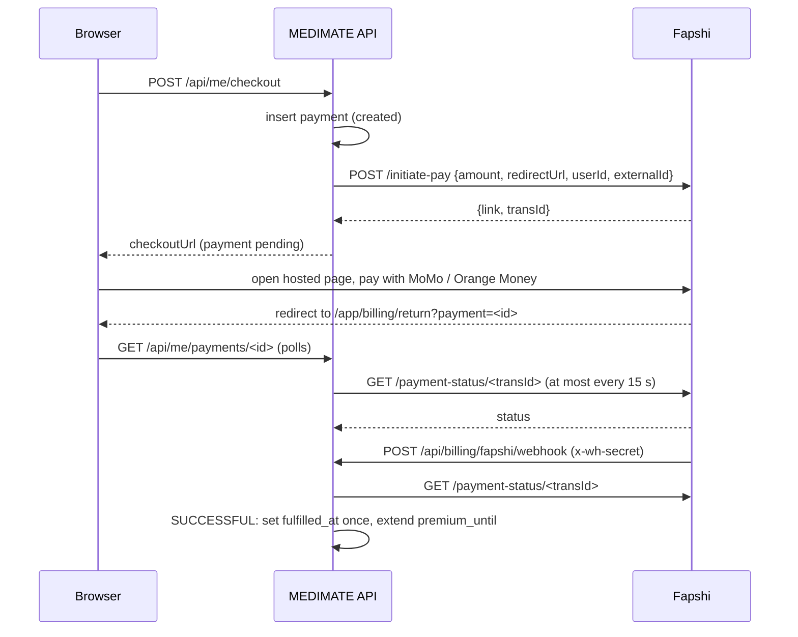

# Payments: test checkout and Fapshi

Code: [`server/src/providers/payments.ts`](../server/src/providers/payments.ts) (adapter), [`server/src/services/billing.ts`](../server/src/services/billing.ts) (rules), [`web/src/pages/app/Billing.tsx`](../web/src/pages/app/Billing.tsx).

## What is free and what is Premium

Every new account gets a trial (30 days by default, set by an admin; server time is authoritative). After it ends, **pharmacy search, price comparison, medicine information and contacting pharmacies stay free**. Reminders, readings, steps, water, streaks and the clinician PDF need Premium. The server enforces this on every premium route (`PREMIUM_REQUIRED`), not just the UI. Price (default 1,000 XAF for 30 days) and the premium feature list are admin settings and placeholders until the operator sets real terms.

## Providers

| `PAYMENTS_PROVIDER` | Behaviour |
|---|---|
| `demo` (default) | A clearly labelled **test checkout**. "Simulate successful payment" adds Premium time. No money moves, no provider is called, and the endpoint is disabled when another provider is configured. |
| `fapshi` | Fapshi hosted checkout for MTN Mobile Money and Orange Money (Cameroon). `FAPSHI_ENV=sandbox` uses `https://sandbox.fapshi.com`, `live` uses `https://live.fapshi.com`. |

## Fapshi flow



Rules the code follows:

1. **Never trust the redirect or the webhook body.** The return page asks our API, and our API asks Fapshi `payment-status` before changing anything. The webhook body is used only to find the `transId`.
2. **Webhook authentication.** When `FAPSHI_WEBHOOK_SECRET` is set, the `x-wh-secret` header must match (constant-time comparison) or the request gets 401. Set the same value on the Fapshi dashboard. It is required for `FAPSHI_ENV=live` in production.
3. **Idempotent fulfilment.** Premium time is added by a conditional update on `fulfilled_at IS NULL`, so repeated webhooks, polls and reconciliation add it exactly once. Premium extends from the later of now and the current Premium end.
4. **Missed webhooks.** Fapshi sends each webhook once. Every reminder-engine tick re-checks up to 20 payments still `created` or `pending` and not checked in the last 2 minutes.
5. **Status-check limit.** Fapshi allows at most **6 status checks per minute** per transaction. The API checks a given payment at most every 15 seconds (4 per minute), whatever the browser does.
6. **Amounts.** Whole XAF only, **minimum 100 XAF** (validated before calling Fapshi).
7. **Links expire after 24 hours.** An unpaid link ends as `EXPIRED`; the person starts a new checkout.
8. Everything is audited: `payment.started`, `payment.fulfilled`.

Status mapping: `CREATED` to created, `PENDING` to pending, `SUCCESSFUL` to successful, `FAILED` to failed, `EXPIRED` to expired.

## Configuration

```
PAYMENTS_PROVIDER=fapshi
FAPSHI_ENV=sandbox
FAPSHI_API_USER=<apiuser of your collection service>
FAPSHI_API_KEY=<apikey of your collection service>      # secret
FAPSHI_WEBHOOK_SECRET=<random string you choose>         # secret, also set on the Fapshi dashboard
APP_ORIGIN=https://<your-domain>                          # used to build the return link
```

On the Fapshi dashboard (sandbox service): set the webhook URL to `https://<your-domain>/api/billing/fapshi/webhook` and the same webhook secret. A localhost URL cannot receive webhooks; locally the return-page polling and the reconciliation tick still complete the payment.

## Sandbox test numbers

Use these on the Fapshi sandbox page. No real money moves in sandbox.

| Result | MTN | Orange |
|---|---|---|
| Success | 670000000, 670000002, 650000000 | 690000000, 690000002, 656000000 |
| Failure | 670000001, 670000003, 650000001 | 690000001, 690000003, 656000001 |

## Going live (production gate)

- A live Fapshi collection service approved for the operator's business, with live keys stored only in the host's secret store.
- Real price and terms, refund handling, receipts, and a privacy notice covering the payment provider.
- `FAPSHI_ENV=live` with `FAPSHI_WEBHOOK_SECRET` set (the server refuses to start in production without it).
- Remove `PUBLIC_DEMO` and `DEMO_MODE` so the test checkout cannot be reached.
