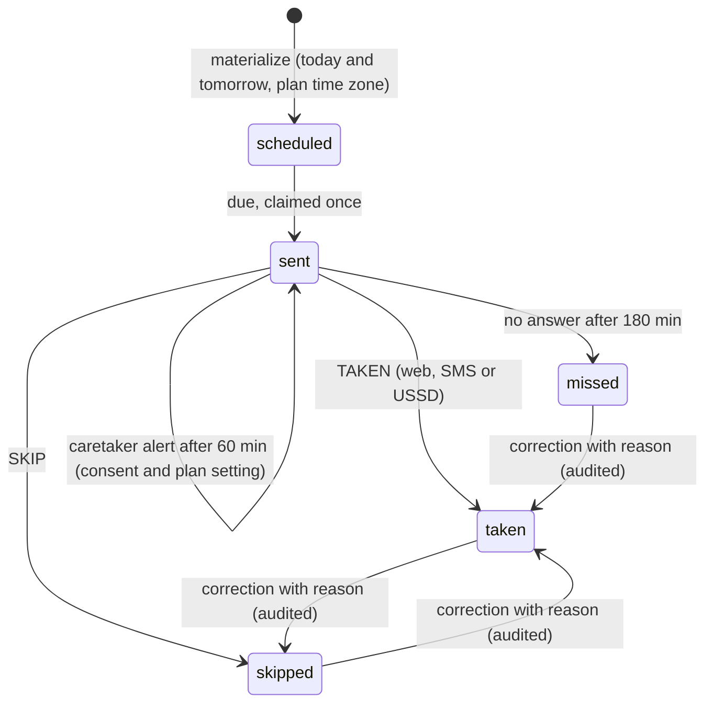

# Reminders

Code: [`server/src/services/reminders.ts`](../server/src/services/reminders.ts) (engine), [`server/src/scheduler.ts`](../server/src/scheduler.ts) (when it runs). Tests: `server/test/api.test.ts` with a fake clock.

## What the app does and does not do

- A person records a medicine **from their own prescription**: name, dose text exactly as written, how often, the times, start and end dates, an optional refill date, and notes.
- MEDIMATE repeats those instructions. It never calculates, suggests or changes a dose, and never creates a clinical schedule. Checkups are only those the person or their care team adds.

## Lifecycle of one reminder

Windows are configurable: `REMINDER_FOLLOWUP_MINUTES` (30), `REMINDER_ESCALATE_MINUTES` (60), `REMINDER_MISSED_MINUTES` (180).

## One engine tick

`runReminderTick` is safe to run repeatedly and concurrently. Every state change is a conditional `UPDATE ... WHERE status = ...`, so two overlapping ticks cannot send the same reminder twice or record two outcomes.

1. **Materialize.** For each active plan, create occurrences for today and tomorrow in the plan's time zone. A unique `dedupe_key` (`med:<plan>:<utc time>`) makes this idempotent. Refill reminders: one, at 09:00 local, two days before the refill date the person entered (this assumption is shown in the UI). Checkup reminders: the day before, if asked.
2. **Deliver due reminders.** Only if the person still has the reminders feature (trial or Premium); otherwise the occurrence is marked `suppressed`. The occurrence is claimed (`scheduled` to `sent`), then:
   - with a phone number, `sms_messages` consent and SMS turned on for the plan: a generic SMS with a short reference code;
   - otherwise: shown in the app only (`web_only`).
3. **Retry failed SMS** with bounded exponential backoff: 30 s, 60 s, 120 s, 240 s ... capped at 15 minutes, at most 5 attempts, then `failed`.
4. **Follow-up** once, for medication reminders still unanswered after the follow-up window.
5. **Caretaker escalation** once, after the escalation window, only if the plan has caretaker alerts on and the caretaker's link is active and shares the `reminders` category. The SMS says only that a reminder was not confirmed, unless the patient allowed detail. Caretakers who sent STOP are not texted.
6. **Missed.** Still unanswered after the missed window: marked `missed` ("Not confirmed" in the UI, never "failed").

The tick also re-checks pending Fapshi payments and purges SMS bodies past their 7-day retention.

## Answering a reminder

`TAKEN` / `SKIP` by SMS, the USSD reminders menu, or the web buttons all call `confirmOccurrence`. Each answer carries an idempotency key (unique in `reminder_events`), so a double tap, a retried request or a duplicated SMS records one outcome. With several open reminders, SMS asks which one. A wrong answer can be corrected later with a reason; the correction is stored as a new event and in the audit log.

## Where the engine runs

| Deployment | Trigger |
|---|---|
| Local / container (`npm run dev`, `npm start`) | In-process interval, `SCHEDULER_INTERVAL_SECONDS` (default 30). |
| Vercel (`SCHEDULER_INTERVAL_SECONDS=0`) | (a) Opening the reminders list (`GET /api/reminders`) runs a tick at most every 30 s per function instance; (b) the simulator's "Run reminder engine now"; (c) Vercel Cron `GET /api/cron/tick` with `Authorization: Bearer $CRON_SECRET`. |

**Limitation on Vercel Hobby:** cron runs at most once a day. Between cron runs, reminders go out only when someone uses the app or the simulator. For dependable delivery at the exact minute, use a paid Vercel plan with a 1 to 5 minute cron, an external scheduler hitting `/api/cron/tick`, or the long-running server. This is documented as a production gate.

## Adherence and streaks

Weekly and monthly summaries count taken, skipped, not confirmed, and not answered yet separately, and show the formula: taken divided by (taken + skipped + not confirmed). Reminders not answered yet are left out of the rate. Streaks count days where every medicine reminder was answered as taken. Copy never shames: "Missing a day happens."

## Time zones

Times are local wall-clock values. Each day's occurrence is converted to UTC with the plan's IANA zone, so daylight-saving changes are handled for zones that have them (Cameroon does not). Tests cover a DST zone and the trial expiry instant.
